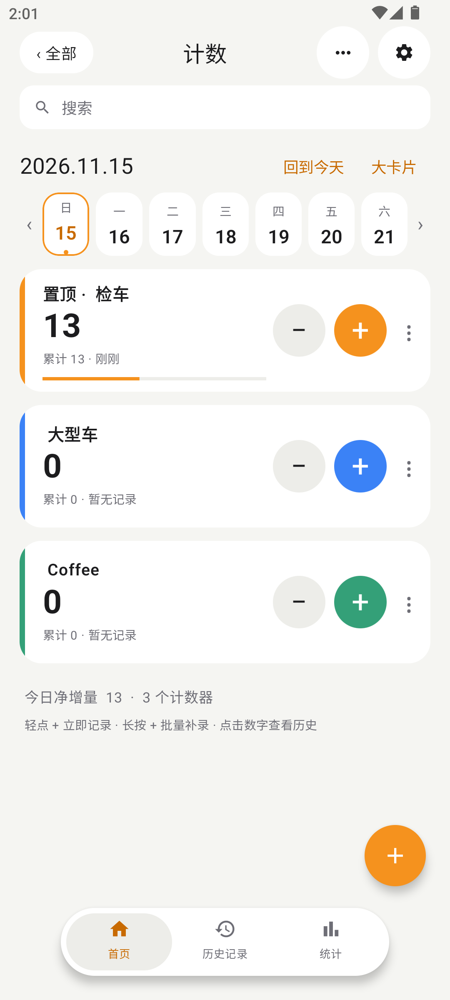
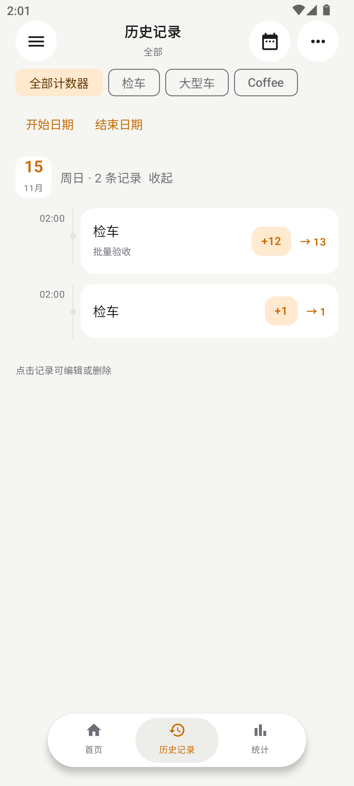
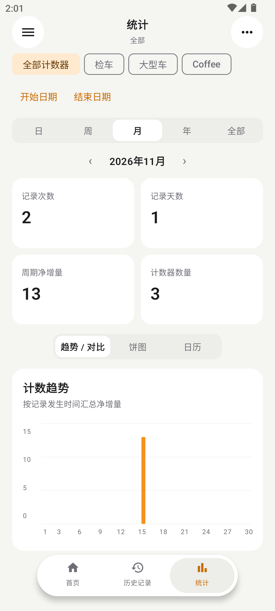
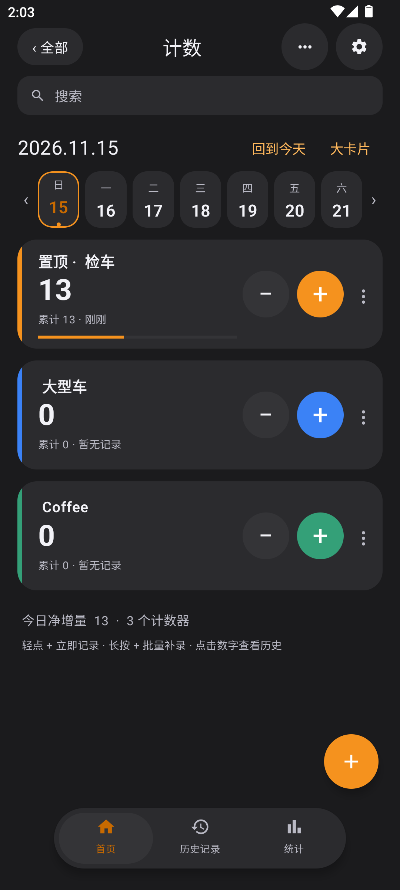
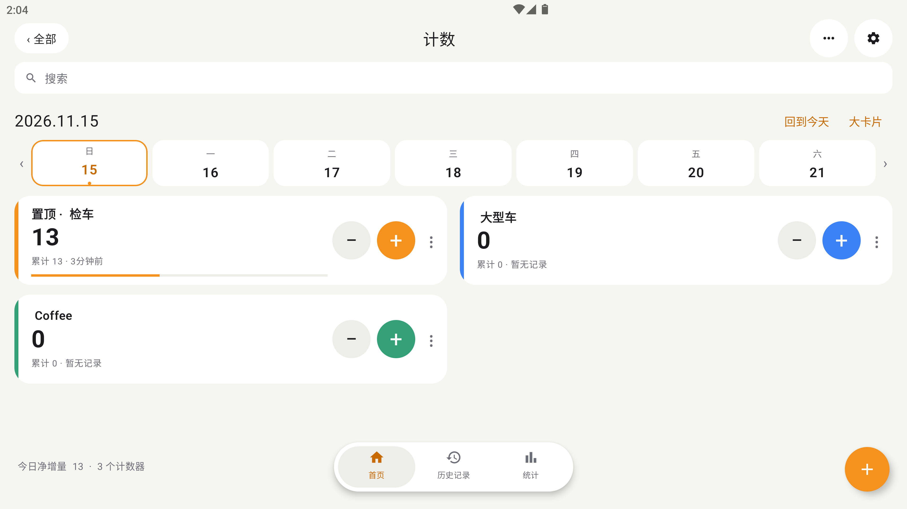

# 2026-11-15 验收记录

环境：MuMu 模拟器，Android 12；APK 来自 GitHub Actions。手机视口使用 1080 × 2400、420 DPI，宽屏使用模拟器原始分辨率 3840 × 2160、540 DPI。

## 构建

- 应用版本：1.1，数据库版本：2。
- [GitHub Actions 构建](https://github.com/rayo1uo/counter-app/actions/runs/43623803963)：应用、设备测试 APK 和 Android Lint 均成功。
- 下载产物的 SHA-256 已与 GitHub artifact digest 比对。

## 设备自动化

最终版 AndroidJUnitRunner 输出 `OK (12 tests)`，耗时 4.216 秒。用例包括：

1. 40 次并发计数，条数、净增量和最终结果一致。
2. 修改计数器名称与置顶后，历史记录保留。
3. 补录、编辑、删除较早记录后，后续结果重算。
4. 每日与累计模式正确处理初始值、跨日和负增量。
5. 撤销指定记录时，保留随后新增的记录。
6. 恢复数据失败时，计数器与记录整体回滚。
7. JSON 备份往返、备注和非法外键校验。
8. 日统计包含一天的最后一毫秒。
9. 删除分类后计数器移到默认分类。
10. 清空后使用操作前快照恢复。
11. 旧版数据库升级后，计数器与历史保留。
12. 界面：一键增加、减少、撤销、长按补录、备注、历史与统计页面切换。

## 补充操作检查

- 新增表单创建 Reading 计数器。
- 深色主题和系统状态栏显示。
- 音量上键使检车从 13 增加到 14。
- 使用系统文件选择器导出每日 CSV，读回合计 14，与界面一致。
- JSON 导出包含 4 个计数器、3 条记录和设置；增加到 15 后导入备份恢复为 14。
- 新增 Reading 后位于现有计数器末尾，删除时显示二次确认。
- 通过应用自身 UID 发出桌面小组件计数广播，置顶计数器从 13 增加到 14，更多菜单撤销后恢复 13。
- 日历点击日期进入对应日期范围的历史，饼图页面正常显示。
- 手机单列与宽屏双列布局、历史时间轴、统计图及弹窗截图检查。

截图和设备运行输出保存在本地 `artifacts/`。

## 界面截图

| 首页 | 历史 | 统计 | 深色主题 |
| --- | --- | --- | --- |
|  |  |  |  |

[设备测试原始输出](instrumentation.txt)
