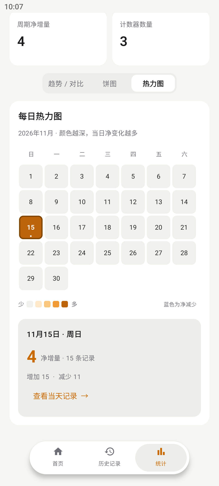
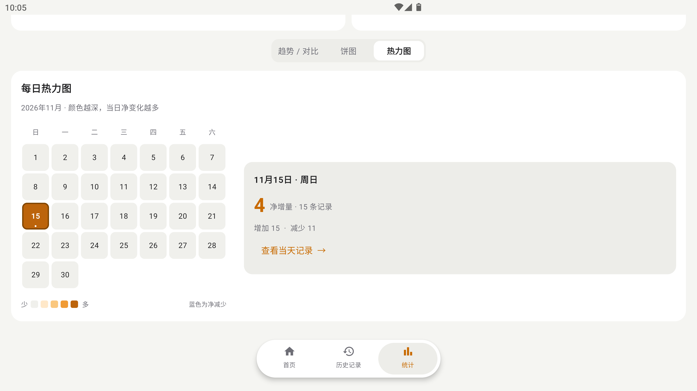

# 热力图与历史点击修复验收

版本：1.2。构建源码：810ef02。[GitHub Actions 构建](https://github.com/rayo1uo/counter-app/actions/runs/43665501273) 已生成应用 APK、独立验收 APK 和测试 APK，Android Lint 通过。

## 变化

- 月度热力图使用固定上限宽度的小方格，在宽屏上保持正方形；颜色分为四档，橙色表示净增加、蓝色表示净减少，并显示强度图例。
- 方格只显示日期；数量与记录数放在选中日期的明细面板，避免两行文字挤出格子。
- 点击日期原位选中，使用“查看当天记录”进入历史；宽屏并排展示，手机上下排列。
- 修复历史卡片内部错误绑定日期折叠事件的问题。点击记录打开编辑，只有日期栏的独立按钮触发折叠；折叠后保留“已收起 N 条记录”提示。
- 移除时间间隔区域错误重复渲染的筛选器。

## 验证

- MuMu / Android 12：`OK (14 tests)`，3.945 秒。包含历史卡片编辑与折叠回归、热力图选日不跳转、显式历史入口、正方形尺寸、负增量、零净增量和空日期。
- 修改前通过实际点击复现“记录未打开编辑、当天分组被收起”；更新后同样的点击返回 `PASS: 点击记录打开编辑`。
- 实际设备中验证热力图原位选择空日期、有记录日期及查看当天记录。
- 更新前后逐项比较计数器、分类和全部 15 条记录，数据完全一致。
- 验收安装包使用 `com.example.counter.validation`，自动化测试与日常使用数据隔离。
- 检查 1080 × 2400 / 420 DPI 手机视口及 3840 × 2160 / 540 DPI 宽屏视口，完成后恢复模拟器原始显示配置。

[设备测试输出](heatmap-instrumentation.txt)

| 手机 | 宽屏 |
| --- | --- |
|  |  |
